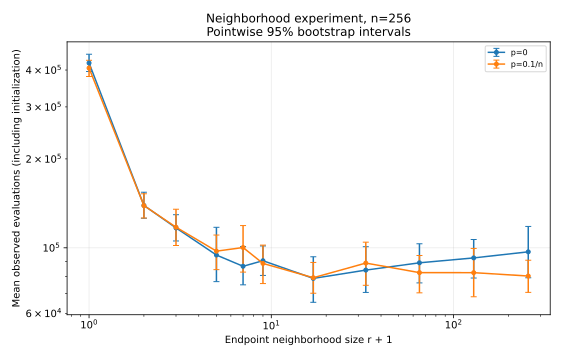
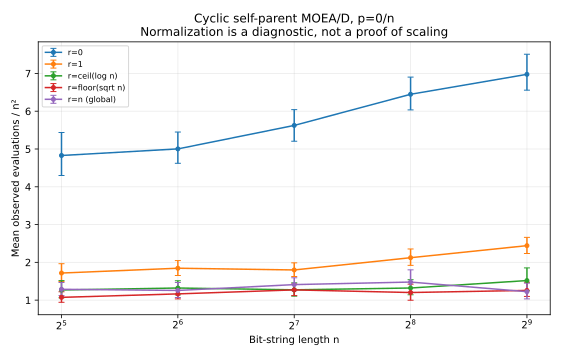
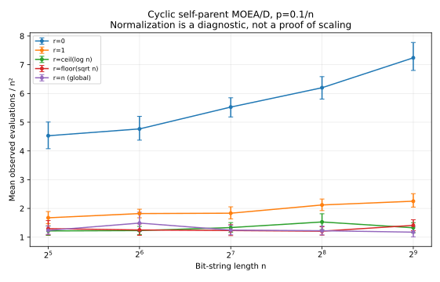
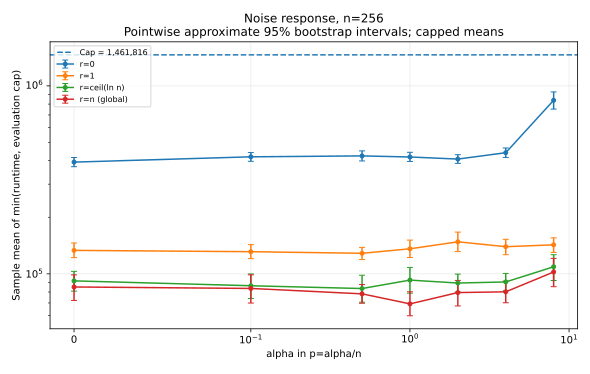
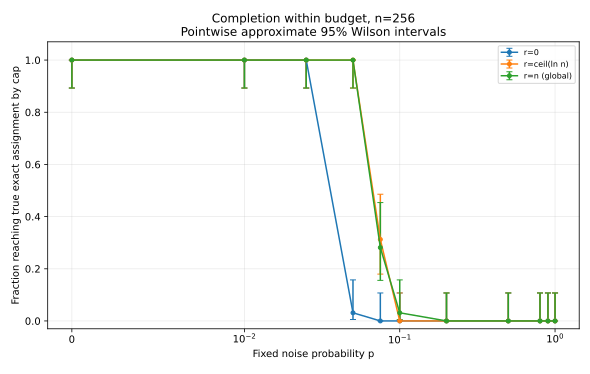

# MOEA/D under prior noise

**Reproducible research on OneMinMax, neighborhood exchange, and evaluation-efficient scheduling.**

The active implementation studies a precisely specified **cyclic, self-parent, Tchebycheff MOEA/D** with one-bit mutation, optional one-bit prior noise, and no parent re-evaluation. It does not represent every implementation called MOEA/D.

> **Research status:** the proposed cyclic full-population law
> `Theta(n² + (n²/T) log(1+n/T))` is **not certified by this repository**.
> The available arguments leave an interior/maximum-time dependency and a matching-lower-bound supply problem unresolved. Finite experiments and zero observed invariant violations cannot close those gaps. See the [claim-by-claim audit](docs/theory-status.md).

## Evidence for larger neighborhoods

Two separate, fully recorded protocols contain **10,848 seeded trials and 16 SVG figures**. They have different evaluation caps and must not be pooled as if they were one runtime experiment.

| Protocol | Trials | Replicates per cell | Noise regimes | Observed outcomes |
|---|---:|---:|---|---|
| [Neighborhoods and scheduling](evidence/neighborhoods/README.md) | 2,144 | 32 | p=0 and p=0.1/n; separate noiseless frontier baseline | 2,144 completed; 0 budget-censored |
| [Expanded noise grid](evidence/noise-grid/README.md) | 8,704 | 32 | p=alpha/n and fixed p, kept separate | 6,535 completed; 2,169 budget-censored |

These are finite observations from the committed protocols, not asymptotic runtime estimates or universal success guarantees. All trial seeds, evaluation budgets, censoring indicators, summaries, and generating-source fingerprints are retained.

### Neighborhood size and scaling

The neighborhood protocol uses `n = 32, 64, 128, 256, 512`, with a denser radius sweep at n=256. Its plots show evaluation counts including initialization, pointwise approximate 95% bootstrap intervals, and scaling diagnostics.







At n=256, for example, the noiseless sample mean was approximately 422,597 evaluations for r=0 and 78,771 for r=16. With p=0.1/n, the corresponding means were approximately 406,316 and 79,193. These are descriptive comparisons of the specified cells; they do not identify an asymptotically optimal radius or show that every radius increase helps.

The same report contains per-acceptance versus per-sweep endpoint-jump histograms, endpoint occupation counts, first-hit profiles, and the separately labeled frontier baseline. **468,983 eligible noiseless endpoint-certificate checks had zero violations.** They are correlated observations within runs, not that many independent statistical trials; the certificate has a separate deterministic proof.

[Raw neighborhood trials](evidence/neighborhoods/runs.csv) · [Summaries](evidence/neighborhoods/summary.csv) · [Diagnostics](evidence/neighborhoods/diagnostics.jsonl) · [Provenance](evidence/neighborhoods/manifest.json)

### Expanded one-bit prior noise

The expanded grid studies alpha in `{0, 0.1, 0.5, 1, 2, 4, 8}` for p=alpha/n at n=32,...,512. A separate fixed-p family uses n=32,64,128,256 and probabilities from 0 to 1. It uses fresh controls and a smaller administrative cap than the original neighborhood protocol. The grid was selected after exploratory pilots, not preregistered as a confirmatory study.





The reported runtime statistic is **the mean of min(runtime, evaluation cap)**. A curve reaching the cap indicates censoring, not runtime saturation. No capped run is discarded, and a survivor-only average is never substituted for the unrestricted expected runtime. Completion intervals are pointwise approximate Wilson intervals; runtime intervals are pointwise approximate bootstrap intervals, not simultaneous confidence bands.

The [full report](evidence/noise-grid/README.md) also separates stored-optimum hits from true exact assignment, plots censored-run terminal errors, and shows size dependence. Those measurements do not establish a polynomial/exponential noise threshold or a stationary distribution. A separate elementary [p=1 obstruction](docs/noise-analysis.md) is proved for this exact model; it is not generalized to p<1.

[Raw noise trials](evidence/noise-grid/runs.csv) · [Summaries](evidence/noise-grid/summary.csv) · [Provenance](evidence/noise-grid/manifest.json) · [Interpretation](docs/noise-analysis.md)

## Install, test, and reproduce

Python 3.11 or newer is required. Direct dependency versions are pinned; each manifest records its actual generating environment.

```bash
python -m venv .venv
source .venv/bin/activate
python -m pip install -r requirements-evidence.txt
python -m pip install -e . --no-deps
python -m pytest -q

# Verify the two committed datasets against their generating-source hashes.
python -m moead.verify --input evidence/neighborhoods --check-source
python -m moead.noise --out evidence/noise-grid --verify --check-source

# Small end-to-end reproduction.
python -m moead.experiments --config experiments/smoke.json --out results-local/smoke
python -m moead.report --input results-local/smoke
python -m moead.verify --input results-local/smoke --check-source

# Reproduce the full neighborhood protocol in a NEW directory.
python -m moead.experiments --config experiments/neighborhoods.json --out results-local/neighborhoods --engine numba
python -m moead.report --input results-local/neighborhoods
python -m moead.verify --input results-local/neighborhoods --check-source

# Reproduce the separate expanded noise grid.
python -m moead.noise --config experiments/noise-grid.json --out results-local/noise --workers 2
python -m moead.noise_report --input results-local/noise
python -m moead.noise --out results-local/noise --verify --check-source
```

Use `--engine python` for the reference simulation path. Numba is optional for the package and recommended for the full grids. Tests compare both execution paths and independent literal-bitstring oracles. Use new output directories; the neighborhood runner supports an explicit `--overwrite`, whereas the expanded-noise runner refuses a nonempty output directory.

CI checks Python 3.11 and 3.13, reproduces the smoke experiment, verifies committed artifacts and generating-source fingerprints, and reconstructs summary tables and evidence READMEs from raw trials. It retains test/environment receipts and an archive of the tested revision. See [the validation record](docs/validation.md) for revision-specific results and the [pull request checks](https://github.com/parthchvn/MOEA-D/pull/1/checks).

## Exact cyclic algorithm contract

For each slot `j=0,...,n`, store its incumbent's true weight `w[j]` and one persistent noisy observation `v[j]`. With the fixed ideal reference point `(n,n)`, the integer scalarization and radius neighborhood are

```text
cost(j, v) = max(j*(n-v), (n-j)*v).
B(k)       = {j : 0 <= j <= n and |j-k| <= r}.
```

Initialize n+1 independent uniform bit strings and evaluate each once. Each cyclic turn k mutates **the current incumbent of k**, flipping exactly one uniformly chosen bit, then evaluates that offspring once. With probability p, evaluation flips one further uniformly chosen bit without changing the stored genotype. The **same observed offspring vector** is offered to every slot in B(k); ties are accepted. Stored parent observations are never refreshed.

Neighborhoods are clipped symmetric intervals. A global neighborhood is r=n; its actual size is n+1. At the endpoint, neighborhood size is r+1. The nominal width `2r+1` is not the actual size of every neighborhood.

The stopping instrument checks `w[j]=j` for every j after every offspring. First full true-front coverage is recorded separately. True weights do not guide noisy selection. Runtime counts objective-vector evaluations, including initialization, not scalar comparisons, CPU time, sweeps, or the number of replacement recipients. See [the complete model and limitations](docs/methodology.md).

## Proof and evidence status

| Item | Status |
|---|---|
| Reduction from bit strings to true/stored weights | Argument in model notes; exact small transition-law tests and coupled bitstring-oracle tests |
| Noiseless endpoint certification and invariant (J) | Deterministic proof after an actual endpoint acceptance; checks enforce that precondition |
| Noiseless endpoint upper bound | Proof supplied; **not** a proof of the simultaneous full-population bound |
| Separate noiseless frontier variant | Conditional mean `1+n(H_w+H_(n-w))-1{0<w<n}`; proof, rational recurrences, and independent bitstring tests |
| Exact p=1 noise obstruction | Proof for the specified one-bit-noise model and exact-assignment criterion; not a threshold theorem for p<1 |
| Cyclic larger-neighborhood full-population Theta-law | Open in the available proof material; experiments are evidence only |
| Constant jump bound, matching lower bound, general noise threshold, novelty priority | Not claimed |

The [frontier baseline](docs/frontier.md) differs in **both scheduling and initialization**. It uses one evaluated initial solution copied into all slots. It is not a neighborhood-only ablation or a noisy-runtime theorem. Its code tracks both actual solved boundaries, including opposite-direction progress from the initial singleton; the expectation includes the corresponding correction.

## Repository map

```text
src/moead/                 simulation, experiments, statistics, and reporting
  model.py                 public API and configuration validation
  kernel.py                integer count-space transitions; optional acceleration
  frontier.py              separate noiseless scheduling baseline
  experiments.py           neighborhood protocol, seeds, raw records, provenance
  noise.py                 scaled/fixed-noise runner and evidence verification
  statistics.py            censoring-aware summaries and Monte Carlo intervals
  report.py / noise_report.py   reports and figures generated from raw trials
  verify.py                neighborhood-artifact integrity verification
experiments/               machine-readable full, noise, and smoke protocols
tests/                     identities, independent oracles, replay and regression tests
docs/                      model, proof audit, noise/frontier notes, validation, migration
evidence/neighborhoods/    2,144 raw trials, diagnostics, summaries, and eight SVGs
evidence/noise-grid/       8,704 raw trials, summaries, and eight SVGs
legacy/                    original scripts and notebook, preserved but not endorsed
references/                PDFs already present in the original repository
.github/workflows/         tests and branch-scoped evidence reproduction
```

## Contributing evidence

Specify the algorithm, initialization, stopping criterion, and cost units before comparing results. Edit a versioned protocol rather than a plotted number. Keep every trial and seed; record timeouts as censored, not negative runtimes. Distinguish a finite observation, conjecture, conditional theorem, and complete proof. Run the tests and regenerate the relevant reports after source changes. Fewer evaluations need not mean less scalar-comparison work or lower wall-clock cost.

Original artifacts are retained with provenance in the [migration audit](docs/migration.md). Historical numerical claims without retained raw trials are not silently combined with freshly generated evidence. Passing tests establish the checked implementation properties, not universal correctness or a missing asymptotic theorem.
