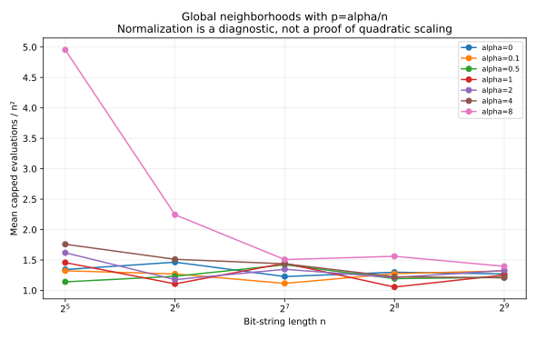
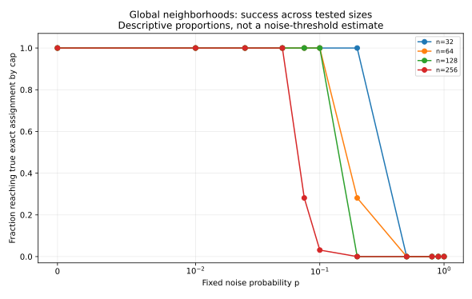
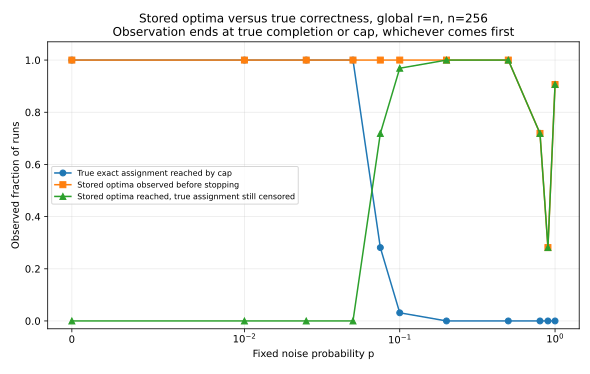

# What the expanded noise experiments suggest

This interpretation is derived from the committed [8,704-trial noise dataset](../evidence/noise-grid/README.md), not from historical plots or an assumed asymptotic law. The [raw records](../evidence/noise-grid/runs.csv), [full summary](../evidence/noise-grid/summary.csv), and [manifest](../evidence/noise-grid/manifest.json) retain every trial. Generating-source revision: `5f1f346973dacf08f7e3502d81076363dc4f9bcc`.

## Design and observation window

There are 32 replicates per cell. The scaled family tests p=alpha/n for alpha in {0, 0.1, 0.5, 1, 2, 4, 8}, n in {32, 64, 128, 256, 512}, and radii 0, 1, ceil(ln n), n. The fixed-p family tests p in {0, 0.01, 0.025, 0.05, 0.075, 0.1, 0.2, 0.5, 0.8, 0.9, 1}, n in {32, 64, 128, 256}, and radii 0, ceil(ln n), n.

The cap, including initialization, is B(n)=(n+1)[1+ceil(4 n ln(n+2))]. At n=256 this is 1,461,816 evaluations; at n=512 it is 6,559,218. All radii and noise values at a given size share that cap. The two families use separate random streams, including separate noiseless controls. The earlier 2,144-trial neighborhood protocol has a larger cap and is not pooled with this dataset.

Of the 8,704 runs, 6,535 reached current true exact assignment and 2,169 reached the cap. These totals combine deliberately different noise regimes; they are not a meaningful single algorithm success probability. Every reported runtime mean below includes capped runs. The grid is exploratory and was selected after pilots.

## 1. The neighborhood benefit persists over a substantially wider scaled-noise range

For n=512, every one of the following cells completed 32/32 trials:

| alpha in p=alpha/n | r=0 | r=1 | r=ceil(ln n)=7 | r=n=512 |
|---:|---:|---:|---:|---:|
| 0 | 1,821,343 | 597,566 | 352,688 | 333,242 |
| 4 | 1,843,244 | 567,848 | 370,138 | 316,672 |
| 8 | 2,621,253 | 614,479 | 383,900 | 365,989 |

Entries are rounded sample means of evaluation counts. Exact values and pointwise approximate bootstrap intervals are in the summary CSV. At alpha=8, the descriptive ratio of the no-exchange mean to the global-neighborhood mean is approximately 7.16; it is not an asymptotic speed-up factor.

For the global neighborhood, normalized means show the following finite-size pattern:

| alpha | n=32 | n=64 | n=128 | n=256 | n=512 |
|---:|---:|---:|---:|---:|---:|
| 0 | 1.344 | 1.465 | 1.229 | 1.299 | 1.271 |
| 4 | 1.759 | 1.511 | 1.438 | 1.224 | 1.208 |
| 8 | 4.954 | 2.244 | 1.507 | 1.561 | 1.396 |

Entries are sample mean min(tau,B)/n². The alpha=8,n=32 global cell has one censored run; the other cells shown have none. The small-size penalty at alpha=8 occurs when actual p is large: 8/32=0.25, versus 8/512=0.015625. This illustrates why fixed alpha and fixed p must not be confused.

**Interpretation:** these data are consistent with a roughly quadratic evaluation scale for growing neighborhoods in the tested p=alpha/n regimes, and with a meaningful benefit over independent subproblems. They do not prove an O(n²) theorem, a matching lower bound, or a bound uniform in alpha. Smaller means at some nonzero alpha values do not establish that noise is beneficial.

## 2. Fixed p is a different regime: success deteriorates with increasing size

Global-neighborhood completions, out of 32 trials per cell:

| Fixed p | n=32 | n=64 | n=128 | n=256 |
|---:|---:|---:|---:|---:|
| 0.05 | 32 | 32 | 32 | 32 |
| 0.075 | 32 | 32 | 32 | 9 |
| 0.1 | 32 | 32 | 32 | 1 |
| 0.2 | 32 | 9 | 0 | 0 |
| 0.5 | 0 | 0 | 0 | 0 |

For example, at p=0.1 all 32 runs finish at n=128, whereas only 1/32 finishes at n=256, despite the larger evaluation budget at the larger n. At p=0.2, completion already deteriorates at n=64. This is finite-budget evidence against simply extrapolating the mild-noise observations to fixed positive p at all sizes.

**Interpretation:** the location of the observed success-to-timeout transition depends on n and the budget. The experiments do not identify a constant noise threshold, establish exponential runtime, or prove that any p<1 makes optimization impossible. The grid also does not locate a possible log(n)/n-scale threshold.

## 3. Exchange helps under moderate fixed noise, but global exchange is not clearly better than logarithmic-radius exchange

At n=256, the radius ceil(ln n) is 6.

| Fixed p | r=0 completions | r=6 completions | r=256 completions |
|---:|---:|---:|---:|
| 0.025 | 32/32 | 32/32 | 32/32 |
| 0.05 | 1/32 | 32/32 | 32/32 |
| 0.075 | 0/32 | 10/32 | 9/32 |
| 0.1 | 0/32 | 0/32 | 1/32 |

At p=0.05 the sample means are 1,443,131 capped evaluations for r=0, 187,615 for r=6, and 183,076 for r=256. The r=0 number is not an estimate of its unrestricted mean: 31 of its 32 runs are censored. The latter two cells have no censored trials. Their pointwise approximate bootstrap intervals are [154,765,222,582] and [142,234,237,733], respectively.

**Interpretation:** exchange materially improves the observed chance of completing within budget at this moderate noise level. These data do not establish a consistent improvement of a global neighborhood over a logarithmic radius. The 10/32 versus 9/32 contrast at p=0.075 is not evidence of a meaningful difference by itself, nor do overlapping intervals prove equivalence. Evaluation efficiency must also be distinguished from scalar-comparison cost.

## 4. Simultaneous true correctness, not just stored optimization, is a major bottleneck

For each of the following n=256,global-neighborhood cells, all 32 runs were observed to reach all stored optima before stopping:

| p | Mean evaluations to all stored optima | True-exact completions / 32 | Stored-optimal but true-exact censored |
|---:|---:|---:|---:|
| 0 | 79,197 | 32 | 0 |
| 0.05 | 88,360 | 32 | 0 |
| 0.075 | 101,162 | 9 | 23 |
| 0.1 | 108,921 | 1 | 31 |
| 0.2 | 118,132 | 0 | 32 |

Stored-time means are computed from all 32 recorded stored_hit values in each cell shown, not from a selected subset of successful runs. The stopping cap is 1,461,816 throughout. The table can be reconstructed directly by grouping runs.csv by family='fixed', n=256, policy='global', and p.

In particular, at p=0.2 all stored scalar optima are reached in an average of about 118,000 evaluations, but none of the 32 true populations becomes exactly assigned by 1.46 million evaluations. Once stored scalar optima are reached, they cannot be lost under non-increasing-cost replacement. These failed runs therefore spend the rest of their observation window after stored optimization, not still searching for stored optima.

**Interpretation:** an interacting noise-repair/simultaneous-correctness analysis is essential. Better stored-fitness propagation alone cannot explain the full runtime under these noise values. The observations motivate studying the population of incorrect incumbents and the probability of eliminating them simultaneously. They do not establish coordinate independence, an exact stationary distribution, or the asymptotic duration of this phase. At larger p, stored optimization can also fail to finish within budget; the bottleneck should not be described as exclusively repair at every p.

## 5. p=1 has a rigorous obstruction, separate from the empirical timeouts

At p=1, a slot whose stored observation equals its target j is permanently truly incorrect: exactly-one-bit noise makes its true weight differ from j, and an optimal stored scalar cost accepts only another observation equal to j. Uniform initialization gives positive probability of such a slot already at time zero. Consequently the unrestricted expected true-exact-assignment time is infinite at p=1 in this specified model, for every radius. This statement has a direct proof in [noise-analysis.md](noise-analysis.md); it is not inferred from 0/32 completions and does not extend to p<1.

## What the experiments do not settle

They do not prove the proposed full-population Theta-law or repair its open upper/lower-bound arguments; establish robustness for every constant alpha or fixed p; estimate an asymptotic polynomial/exponential threshold; show that noise helps; show that bigger neighborhoods always help; or measure a stationary error law. A 32/32 completion count still has an approximate pointwise Wilson lower endpoint near 0.893, and 0/32 has an upper endpoint near 0.107. Multiple-grid comparisons are exploratory, not simultaneous-confidence claims.

**Research implication:** the strongest supported direction is to analyze the low-noise neighborhood speed-up and the post-stored-optimization correctness process separately. The first has clear finite-size evidence in p=alpha/n; the second is where the fixed-p experiment exhibits a pronounced failure to attain simultaneous correctness within budget.
