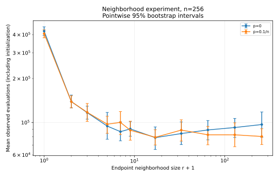
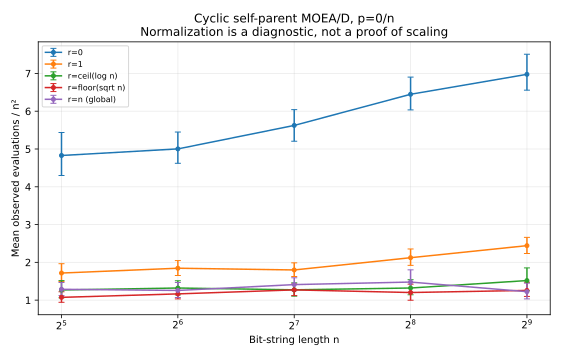
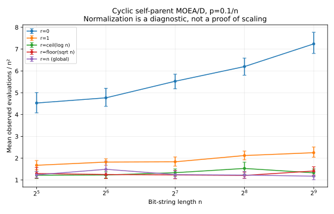
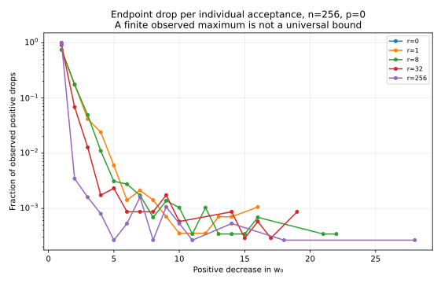
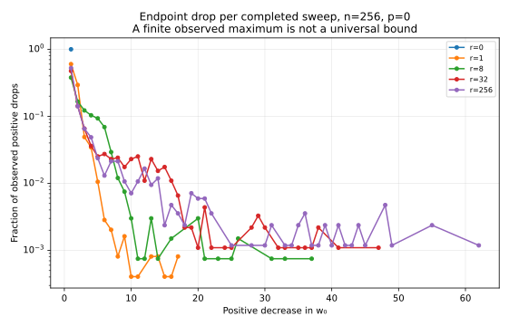
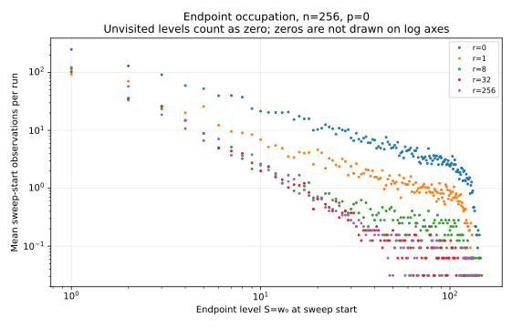
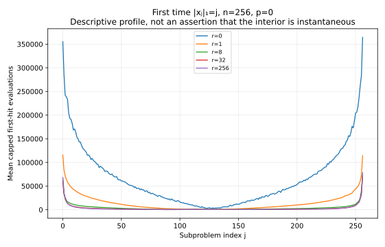
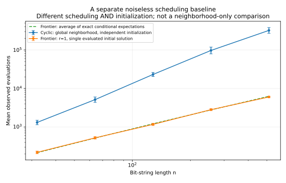

# Reproducible neighborhood evidence

Generated from **2,144 trials**, with **0 right-censored trials**.
Protocol: 32 replicates per cell; n in [32, 64, 128, 256, 512]; p=alpha/n.
Noiseless certificate checks at eligible completed sweep boundaries: **468,983**; violations: **0**.
The certificate is also proved in ../../docs/theory-status.md; finite checks alone are not a proof.

## Reading the figures

Raw trials are in `runs.csv`; all diagnostic arrays are in `diagnostics.jsonl`.
`manifest.json` records source-file hashes, source commit when available, RNG, environment, and data hashes.
Evaluation counts include initialization and stop at the first true exact assignment, checked after every offspring.
One noisy objective vector is shared across replacement comparisons; parents are not re-evaluated.
The reference point is fixed at (n,n). Radii define clipped symmetric intervals, not shifted fixed-width windows.

**Uncertainty:** vertical segments are pointwise 95% percentile bootstrap intervals (2,000 resamples) for the sample mean.
These are approximate Monte Carlo intervals, not finite-sample coverage guarantees or simultaneous confidence bands.
If a cell is censored, the plotted statistic is the mean of min(runtime, budget), NOT the unconditional runtime mean.
The summary leaves the unconditional mean field empty in such cells; no failed run is discarded.
No censored runs in a finite experiment does not prove a tail bound or an asymptotic runtime.

## Runtime by radius

All tested radii at n=256:

| alpha | radius r | completed / trials | mean observed evaluations | bootstrap interval |
|---:|---:|---:|---:|---:|
| 0 | 0 | 32/32 | 422596.9 | [395446.4, 452369.8] |
| 0 | 1 | 32/32 | 139157.9 | [125905.6, 154250.6] |
| 0 | 2 | 32/32 | 116783.0 | [105466.6, 129473.3] |
| 0 | 4 | 32/32 | 94512.4 | [76818.6, 117355.9] |
| 0 | 6 | 32/32 | 86585.6 | [74915.9, 101003.1] |
| 0 | 8 | 32/32 | 90424.3 | [80632.5, 101435.4] |
| 0 | 16 | 32/32 | 78771.0 | [65363.7, 93238.3] |
| 0 | 32 | 32/32 | 84047.5 | [70610.9, 100881.7] |
| 0 | 64 | 32/32 | 88954.4 | [76064.3, 103193.3] |
| 0 | 128 | 32/32 | 92424.2 | [78987.5, 106714.3] |
| 0 | 256 | 32/32 | 96905.8 | [79164.7, 118142.1] |
| 0.1 | 0 | 32/32 | 406316.2 | [380372.3, 431598.4] |
| 0.1 | 1 | 32/32 | 138989.5 | [126130.4, 152411.4] |
| 0.1 | 2 | 32/32 | 117426.4 | [101787.4, 135096.2] |
| 0.1 | 4 | 32/32 | 97422.7 | [84352.4, 110452.1] |
| 0.1 | 6 | 32/32 | 100219.6 | [82734.6, 118922.9] |
| 0.1 | 8 | 32/32 | 88511.2 | [75658.8, 102104.8] |
| 0.1 | 16 | 32/32 | 79192.9 | [70176.1, 89208.8] |
| 0.1 | 32 | 32/32 | 88770.1 | [74644.4, 104485.9] |
| 0.1 | 64 | 32/32 | 82398.0 | [70387.4, 94159.9] |
| 0.1 | 128 | 32/32 | 82379.3 | [68260.7, 99533.2] |
| 0.1 | 256 | 32/32 | 80242.7 | [70649.5, 90740.3] |

## Scaling diagnostics

Dividing by n² visualizes a candidate scaling; flat-looking curves do not establish a Theta-law.

## Claims not established

These finite experiments do not prove a matching lower bound, a noise threshold, bounded endpoint jumps,
or that endpoint optimization alone controls all subproblems. No fitted asymptotic law is presented as a theorem.
The frontier plot concerns a separate noiseless algorithm and initialization; it is not a noisy-runtime result.
See ../../docs/theory-status.md and ../../docs/methodology.md for the precise status and limitations.
