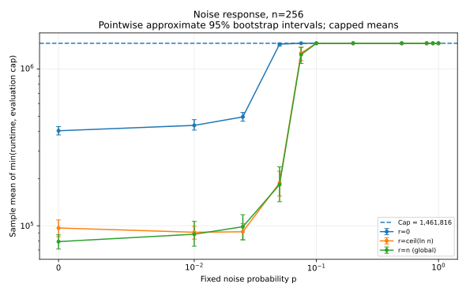
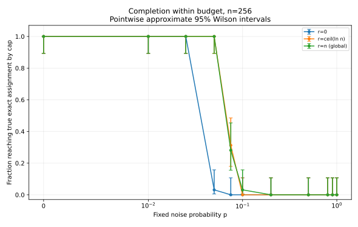
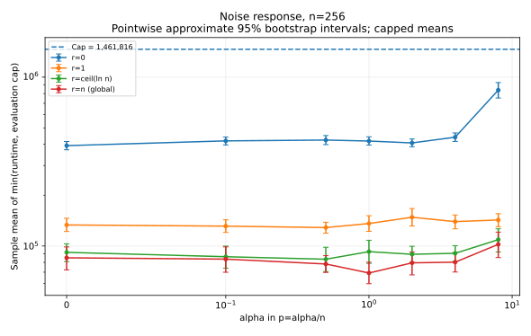
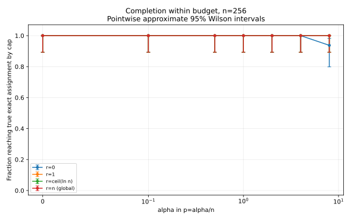
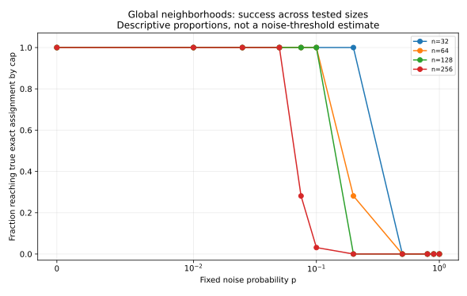
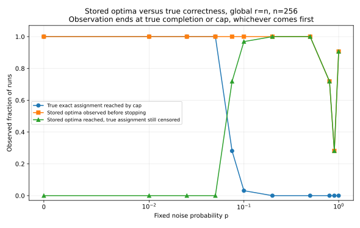
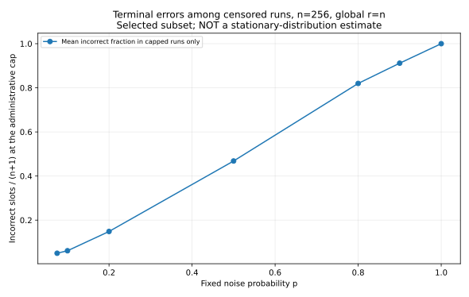
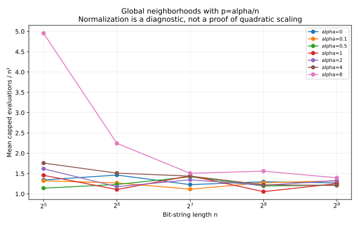

# Expanded one-bit prior-noise evidence

**8,704 new seeded trials; 6,535 completed; 2,169 right-censored.**

The cyclic self-parent Tchebycheff simulator is unchanged. This dataset is separate from the original neighborhood experiment.
Its grid was selected after exploratory pilot runs; it is not a preregistered confirmatory study.

## Protocol

Every cell has 32 independent seeded replicates. The families are:

- scaled: n=[32, 64, 128, 256, 512]; noise values=[0, 0.1, 0.5, 1, 2, 4, 8]; radius policies=['self', 'local', 'log', 'global'].
- fixed: n=[32, 64, 128, 256]; noise values=[0, 0.01, 0.025, 0.05, 0.075, 0.1, 0.2, 0.5, 0.8, 0.9, 1]; radius policies=['self', 'log', 'global'].

`scaled` means p=alpha/n; `fixed` means p is held constant across n. All logarithms are natural.
The common evaluation cap at a given n is B=(n+1)[1+ceil(4 n ln(n+2))], including initialization.
The original neighborhood experiment used factor 20; this expanded grid uses its own fresh controls and a smaller fixed cap.
No early stopping based on apparent failure is used. All 32 attempts (or the protocol-specified count) remain in every mean.

## Interpretation and uncertainty

The estimand is E[min(tau,B)], not the unrestricted E[tau]. A plateau at the cap is a timeout effect, not runtime saturation.
Bootstrap intervals use 2,000 percentile resamples; completion intervals use the Wilson approximation. Both are pointwise approximate 95% intervals, not simultaneous guarantees.
An all-censored cell has a degenerate empirical bootstrap interval at B. This says nothing about the unrestricted runtime or its upper tail.
32/32 successes do not prove success probability one; 0/32 does not prove impossibility.
Stored-optimum hits are observed only until min(tau,B). Their counts are not a separate uncensored hitting-time experiment.
Terminal error averages use censored runs only; they are not stationary-error estimates.
No exponential-runtime, universal monotonicity, polynomial-noise threshold, or full-population Theta-law is inferred from these data.

## Figures

















## All cells at n=256

| Family | alpha or p | radius r | exact / trials | stored hit observed | stored hit but exact censored | mean capped evaluations | bootstrap interval |
|---|---:|---:|---:|---:|---:|---:|---:|
| fixed | 0 | 0 | 32/32 | 32 | 0 | 403988.7 | [380046.0, 429666.6] |
| fixed | 0 | 6 | 32/32 | 32 | 0 | 96736.9 | [85059.2, 108913.8] |
| fixed | 0 | 256 | 32/32 | 32 | 0 | 79196.5 | [70987.4, 87492.8] |
| fixed | 0.01 | 0 | 32/32 | 32 | 0 | 437179.1 | [407834.7, 475429.8] |
| fixed | 0.01 | 6 | 32/32 | 32 | 0 | 90856.6 | [82150.6, 99187.5] |
| fixed | 0.01 | 256 | 32/32 | 32 | 0 | 88280.5 | [74013.3, 106583.3] |
| fixed | 0.025 | 0 | 32/32 | 32 | 0 | 495187.4 | [464836.6, 528645.3] |
| fixed | 0.025 | 6 | 32/32 | 32 | 0 | 91505.1 | [81519.5, 103387.3] |
| fixed | 0.025 | 256 | 32/32 | 32 | 0 | 98551.4 | [81149.5, 117669.1] |
| fixed | 0.05 | 0 | 1/32 | 32 | 31 | 1443131.4 | [1405762.1, 1461816.0] |
| fixed | 0.05 | 6 | 32/32 | 32 | 0 | 187614.9 | [154764.6, 222582.3] |
| fixed | 0.05 | 256 | 32/32 | 32 | 0 | 183075.8 | [142234.0, 237733.1] |
| fixed | 0.075 | 0 | 0/32 | 32 | 32 | 1461816.0 | [1461816.0, 1461816.0] |
| fixed | 0.075 | 6 | 10/32 | 32 | 22 | 1265714.2 | [1132938.2, 1381839.8] |
| fixed | 0.075 | 256 | 9/32 | 32 | 23 | 1236681.2 | [1086731.0, 1375391.0] |
| fixed | 0.1 | 0 | 0/32 | 32 | 32 | 1461816.0 | [1461816.0, 1461816.0] |
| fixed | 0.1 | 6 | 0/32 | 32 | 32 | 1461816.0 | [1461816.0, 1461816.0] |
| fixed | 0.1 | 256 | 1/32 | 32 | 31 | 1461467.9 | [1460771.8, 1461816.0] |
| fixed | 0.2 | 0 | 0/32 | 32 | 32 | 1461816.0 | [1461816.0, 1461816.0] |
| fixed | 0.2 | 6 | 0/32 | 32 | 32 | 1461816.0 | [1461816.0, 1461816.0] |
| fixed | 0.2 | 256 | 0/32 | 32 | 32 | 1461816.0 | [1461816.0, 1461816.0] |
| fixed | 0.5 | 0 | 0/32 | 21 | 21 | 1461816.0 | [1461816.0, 1461816.0] |
| fixed | 0.5 | 6 | 0/32 | 32 | 32 | 1461816.0 | [1461816.0, 1461816.0] |
| fixed | 0.5 | 256 | 0/32 | 32 | 32 | 1461816.0 | [1461816.0, 1461816.0] |
| fixed | 0.8 | 0 | 0/32 | 0 | 0 | 1461816.0 | [1461816.0, 1461816.0] |
| fixed | 0.8 | 6 | 0/32 | 24 | 24 | 1461816.0 | [1461816.0, 1461816.0] |
| fixed | 0.8 | 256 | 0/32 | 23 | 23 | 1461816.0 | [1461816.0, 1461816.0] |
| fixed | 0.9 | 0 | 0/32 | 0 | 0 | 1461816.0 | [1461816.0, 1461816.0] |
| fixed | 0.9 | 6 | 0/32 | 14 | 14 | 1461816.0 | [1461816.0, 1461816.0] |
| fixed | 0.9 | 256 | 0/32 | 9 | 9 | 1461816.0 | [1461816.0, 1461816.0] |
| fixed | 1 | 0 | 0/32 | 0 | 0 | 1461816.0 | [1461816.0, 1461816.0] |
| fixed | 1 | 6 | 0/32 | 32 | 32 | 1461816.0 | [1461816.0, 1461816.0] |
| fixed | 1 | 256 | 0/32 | 29 | 29 | 1461816.0 | [1461816.0, 1461816.0] |
| scaled | 0 | 0 | 32/32 | 32 | 0 | 392985.7 | [371443.4, 415811.4] |
| scaled | 0 | 1 | 32/32 | 32 | 0 | 133279.3 | [121963.0, 145937.5] |
| scaled | 0 | 6 | 32/32 | 32 | 0 | 91742.0 | [80866.1, 103042.6] |
| scaled | 0 | 256 | 32/32 | 32 | 0 | 85132.1 | [72200.9, 98753.2] |
| scaled | 0.1 | 0 | 32/32 | 32 | 0 | 419282.6 | [396921.3, 441709.0] |
| scaled | 0.1 | 1 | 32/32 | 32 | 0 | 131158.9 | [120459.8, 142943.5] |
| scaled | 0.1 | 6 | 32/32 | 32 | 0 | 86419.1 | [73937.6, 99827.9] |
| scaled | 0.1 | 256 | 32/32 | 32 | 0 | 83622.1 | [69904.5, 98813.9] |
| scaled | 0.5 | 0 | 32/32 | 32 | 0 | 423994.4 | [398594.8, 450866.4] |
| scaled | 0.5 | 1 | 32/32 | 32 | 0 | 128591.2 | [119064.7, 138292.7] |
| scaled | 0.5 | 6 | 32/32 | 32 | 0 | 83522.8 | [70609.5, 98266.3] |
| scaled | 0.5 | 256 | 32/32 | 32 | 0 | 78258.8 | [69760.8, 87652.4] |
| scaled | 1 | 0 | 32/32 | 32 | 0 | 418419.8 | [396332.3, 443064.2] |
| scaled | 1 | 1 | 32/32 | 32 | 0 | 135874.0 | [122119.8, 151215.5] |
| scaled | 1 | 6 | 32/32 | 32 | 0 | 92605.6 | [78894.0, 108165.3] |
| scaled | 1 | 256 | 32/32 | 32 | 0 | 69213.6 | [59856.3, 80266.1] |
| scaled | 2 | 0 | 32/32 | 32 | 0 | 407801.9 | [386906.7, 430302.0] |
| scaled | 2 | 1 | 32/32 | 32 | 0 | 148018.4 | [131315.5, 166787.9] |
| scaled | 2 | 6 | 32/32 | 32 | 0 | 89346.8 | [80067.0, 99696.2] |
| scaled | 2 | 256 | 32/32 | 32 | 0 | 79493.6 | [67483.6, 92264.7] |
| scaled | 4 | 0 | 32/32 | 32 | 0 | 440940.1 | [416191.6, 467258.3] |
| scaled | 4 | 1 | 32/32 | 32 | 0 | 139460.2 | [126432.4, 152686.2] |
| scaled | 4 | 6 | 32/32 | 32 | 0 | 90536.0 | [81256.0, 100461.2] |
| scaled | 4 | 256 | 32/32 | 32 | 0 | 80230.3 | [70145.1, 91482.2] |
| scaled | 8 | 0 | 30/32 | 32 | 2 | 838051.5 | [751985.7, 928872.5] |
| scaled | 8 | 1 | 32/32 | 32 | 0 | 142640.2 | [129941.7, 155456.1] |
| scaled | 8 | 6 | 32/32 | 32 | 0 | 109064.3 | [92146.5, 126428.0] |
| scaled | 8 | 256 | 32/32 | 32 | 0 | 102314.3 | [85444.8, 120892.7] |

## Global scaled-noise cells at all sizes

| n | alpha | actual p | exact / trials | mean capped evaluations / n² |
|---:|---:|---:|---:|---:|
| 32 | 0 | 0 | 32/32 | 1.3440 |
| 64 | 0 | 0 | 32/32 | 1.4645 |
| 128 | 0 | 0 | 32/32 | 1.2286 |
| 256 | 0 | 0 | 32/32 | 1.2990 |
| 512 | 0 | 0 | 32/32 | 1.2712 |
| 32 | 0.1 | 0.003125 | 32/32 | 1.3227 |
| 64 | 0.1 | 0.0015625 | 32/32 | 1.2712 |
| 128 | 0.1 | 0.00078125 | 32/32 | 1.1160 |
| 256 | 0.1 | 0.000390625 | 32/32 | 1.2760 |
| 512 | 0.1 | 0.0001953125 | 32/32 | 1.3211 |
| 32 | 0.5 | 0.015625 | 32/32 | 1.1414 |
| 64 | 0.5 | 0.0078125 | 32/32 | 1.2327 |
| 128 | 0.5 | 0.00390625 | 32/32 | 1.4223 |
| 256 | 0.5 | 0.001953125 | 32/32 | 1.1941 |
| 512 | 0.5 | 0.0009765625 | 32/32 | 1.2157 |
| 32 | 1 | 0.03125 | 32/32 | 1.4578 |
| 64 | 1 | 0.015625 | 32/32 | 1.1081 |
| 128 | 1 | 0.0078125 | 32/32 | 1.4466 |
| 256 | 1 | 0.00390625 | 32/32 | 1.0561 |
| 512 | 1 | 0.001953125 | 32/32 | 1.2540 |
| 32 | 2 | 0.0625 | 32/32 | 1.6191 |
| 64 | 2 | 0.03125 | 32/32 | 1.1778 |
| 128 | 2 | 0.015625 | 32/32 | 1.3477 |
| 256 | 2 | 0.0078125 | 32/32 | 1.2130 |
| 512 | 2 | 0.00390625 | 32/32 | 1.3285 |
| 32 | 4 | 0.125 | 32/32 | 1.7586 |
| 64 | 4 | 0.0625 | 32/32 | 1.5115 |
| 128 | 4 | 0.03125 | 32/32 | 1.4379 |
| 256 | 4 | 0.015625 | 32/32 | 1.2242 |
| 512 | 4 | 0.0078125 | 32/32 | 1.2080 |
| 32 | 8 | 0.25 | 31/32 | 4.9536 |
| 64 | 8 | 0.125 | 32/32 | 2.2438 |
| 128 | 8 | 0.0625 | 32/32 | 1.5069 |
| 256 | 8 | 0.03125 | 32/32 | 1.5612 |
| 512 | 8 | 0.015625 | 32/32 | 1.3961 |

## Reproduce and audit

```bash
python -m moead.noise --config experiments/noise-grid.json --out results-local/noise --workers 2
python -m moead.noise_report --input results-local/noise
python -m moead.noise --out results-local/noise --verify --check-source
```

Raw trials: `runs.csv`. Full summaries: `summary.csv`. Protocol: `config.json`. Source/environment/data hashes: `manifest.json`.
The deterministic p=1 obstruction is explained separately in [the noise-analysis notes](../../docs/noise-analysis.md).
