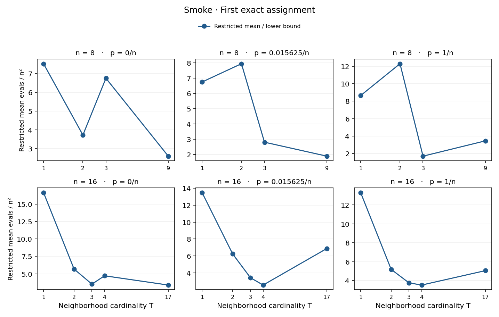
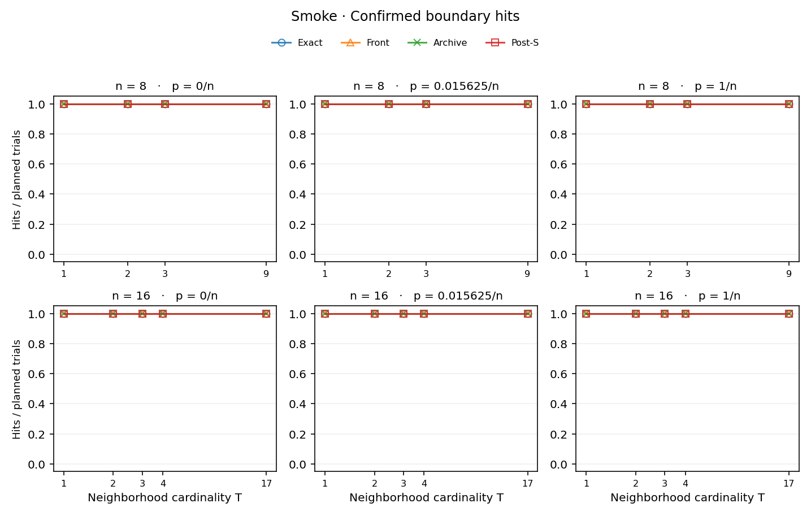
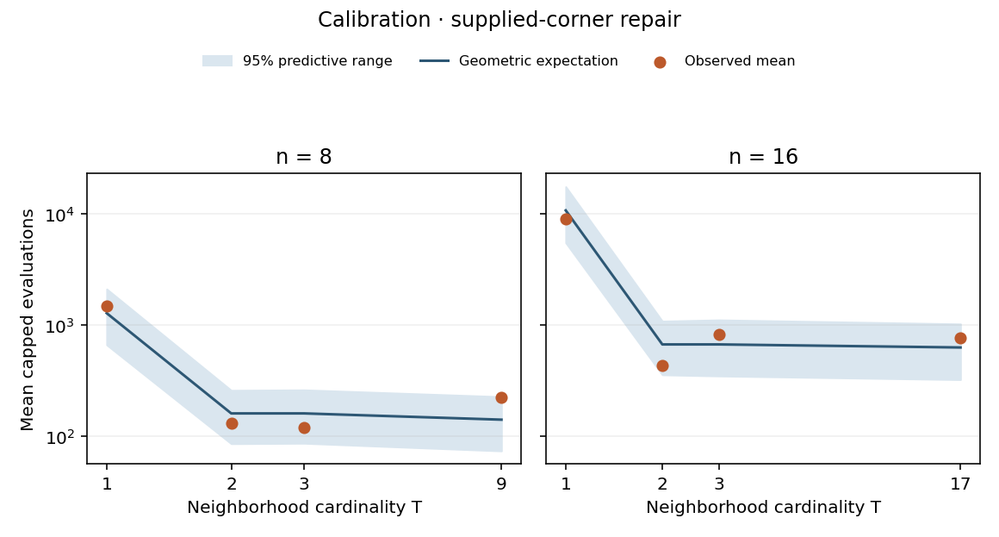
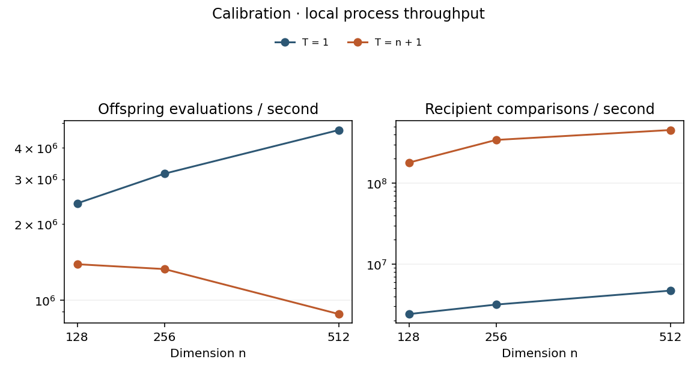

# Larger-neighborhood campaign

The primary endpoint is first exact assignment at a sweep boundary. Evaluations include n + 1 initial observations for uniform starts. Each subsequent sweep costs n + 1 evaluations. All cohorts and stopping events are retained in cells.csv.

| Stage | Planned | Verified receipts | Missing | Role |
|---|---:|---:|---:|---|
| smoke | 62 | 62 | 0 | mechanics only |
| calibrate | 102 | 102 | 0 | timing and corner controls |

## Finite-size contrasts

Ratio = mean exact evaluations at T=1 divided by the mean at T=ceil(sqrt(n)). Values above one favor the larger neighborhood. Each arm uses independent trials. Intervals are deterministic, pointwise 95% percentile bootstraps with 10,000 independent-arm resamples; no multiplicity correction. The primary contrast is n=256, factor=1/64, T=1 vs 16. Independent confirmation is n=512, factor=1/64, T=1 vs 23. Other intervals are exploratory. Repeated seeds are rejected.

Pending — both the n=256 primary and independent n=512 confirmation are required.

Only control or timing stages are present. These samples support execution and instrumentation checks; the primary contrasts await main/holdout.

## Local throughput benchmark

Aggregated over received timing trials; elapsed cost includes engine process start. Comparisons count recipient tests.

| n | T | Receipts | Attempts/s | Recipient comparisons/s |
|---:|---:|---:|---:|---:|
| 128 | 1 | 1/1 | 2,412,803 | 2,412,803 |
| 128 | 129 | 1/1 | 1,387,037 | 178,927,728 |
| 256 | 1 | 1/1 | 3,160,734 | 3,160,734 |
| 256 | 257 | 1/1 | 1,327,313 | 341,119,407 |
| 512 | 1 | 1/1 | 4,700,817 | 4,700,817 |
| 512 | 513 | 1/1 | 881,433 | 452,174,950 |

## Supplied-corner benchmark

With inactive noise and all stored labels pinned, only slot zero needs repair. Each sweep has independent success opportunities from its eligible donors. The analytical restricted expectation uses the resulting geometric law and each cell's actual cap. The last column is a central model-predictive 95% range for the planned sample mean, using 10,000 deterministic Monte Carlo draws of independent capped geometric samples of that size. No initialization evaluations are charged. See research/LARGE_T_THEORY.md for the derivation.

| Stage | n | T | Receipts / planned | Restricted mean evals [lower, upper] | Analytic | Prediction range |
|---|---:|---:|---:|---:|---:|---:|
| calibrate | 8 | 1 | 12/12 | [1488.8, 1488.8] | 1283.4 | [666.0, 2115.9] |
| calibrate | 8 | 2 | 12/12 | [132.8, 132.8] | 161.4 | [86.2, 260.2] |
| calibrate | 8 | 3 | 12/12 | [121.5, 121.5] | 161.4 | [87.0, 262.5] |
| calibrate | 8 | 9 | 12/12 | [225.8, 225.8] | 141.8 | [74.2, 228.0] |
| calibrate | 16 | 1 | 12/12 | [8927.8, 8927.8] | 10742.1 | [5502.1, 17554.0] |
| calibrate | 16 | 2 | 12/12 | [436.3, 436.3] | 672.4 | [358.4, 1088.0] |
| calibrate | 16 | 3 | 12/12 | [830.2, 830.2] | 672.4 | [349.9, 1116.3] |
| calibrate | 16 | 17 | 12/12 | [769.2, 769.2] | 631.1 | [324.4, 1027.1] |

## Observation horizon and computational work

At cap K, the restricted cost is initialization + (n+1) min(first-hit sweep,K). A missing receipt supplies no confirmed trajectory prefix. For that planned trial the restricted cost is bounded by initialization and initialization + (n+1)K. First exact assignment can occur before S, when stored labels have not all reached their targets. The shaded range in a runtime plot (when present) is a missing-data identification range, not a sampling interval. Completion plots count confirmed hits divided by all planned trials. Unrestricted means and quantiles are withheld if any required trial is missing or the event is cap-censored. Even fully observed finite samples cannot exclude rare longer trajectories.

For each event, cells.csv gives lower and upper restricted-mean logical comparison counts. At boundary s these equal T(n+1)s. Initialization contributes zero recipient comparisons. Wall time in work.csv covers each entire receipted run through the post-S endpoint or cap. An earlier exact boundary has no separate elapsed timestamp.

The phase columns in work.csv are mean_observed_U_sweeps (first ideal reference), mean_observed_S_minus_U_sweeps (from U to stored alignment), and mean_observed_phase_II_sweeps (from S to first post-S exact assignment). Each includes only trajectories that reached its end boundary. Its observed_* count gives the denominator and planned gives the total scheduled. The three durations sum to the post-S hitting sweep on a single completed trajectory. Cell means using different observed sets need not add. True/stored mismatch counts and maximum absolute errors at U and S use the same boundary-conditional convention. First corner donor counts classify the first observed endpoint-zero repair as own or external.

## Plots

Runtime and completion plots show uniform, moving-reference bitwise/bitwise cells. Each panel holds dimension and noise factor fixed. Calibration figures compare capped corner means with the geometric model and show measured throughput. Observed corner means are plotted only when all receipts are present. All trial types appear in the CSVs.

